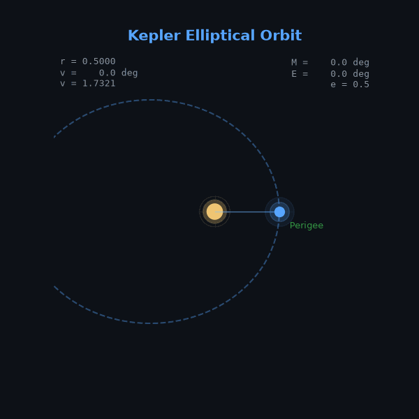

<div align="center">

<!-- Animated Header -->


<!-- Typing SVG -->
<a href="https://git.io/typing-svg">
  
</a>

<!-- Snake Animation -->


</div>

---

<!-- Orbit Animation -->
<div align="center">

## 🛰️ Kepler Elliptical Orbit



**正在学习：轨道方程 (Orbital Equations)**

| 公式 | 说明 |
|:----:|:----:|
| `r = a(1 - e²) / (1 + e·cos ν)` | 轨道方程 — 真近点角 ν 到轨道半径 r |
| `M = E - e·sin E` | 开普勒方程 — 平近点角 M ↔ 偏近点角 E |
| `tan(ν/2) = √((1+e)/(1-e)) · tan(E/2)` | 近点角变换 — 偏近点角 E → 真近点角 ν |
| `v = √(μ(2/r - 1/a))` | 活力公式 (Vis-Viva) — 瞬时速度 v |
| `T = 2π√(a³/μ)` | 开普勒第三定律 — 轨道周期 T |

动画演示了开普勒第二定律（等面积定律）：卫星在近日点速度最快，在远地点速度最慢。

**🛠️ 生成方式**

用 Python + matplotlib 从轨道方程直接求解并渲染，源码在 [`generate_orbit_gif.py`](generate_orbit_gif.py)：

```python
# 1) 数值求解开普勒方程 M = E - e·sin(E)（Newton-Raphson）
E = solve_kepler(M, e)

# 2) 由偏近点角变换得真近点角
nu = 2 * arctan2(sqrt(1+e)·sin(E/2), sqrt(1-e)·cos(E/2))

# 3) 轨道方程求半径，再转直角坐标
r = a(1-e²) / (1 + e·cos(nu))
x, y = r·cos(nu), r·sin(nu)
```

参数：半长轴 `a = 1.0`、离心率 `e = 0.5`。改这两个值就能生成不同轨道。

</div>

---

<!-- About Section -->
## 🧑‍💻 About Me

```yaml
name: DCDannyCheung
location: 🌏 China
current_focus: Orbital mechanics & Kepler's laws
code_motto: "Code is poetry, keep it clean."
hobbies: [coding, orbital mechanics, gaming, exploring new tech]
```

---

<!-- Tech Stack -->
## 🛠️ Tech Stack

<table>
<tr>
<td align="center" width="50%">

### 💻 Languages


<br/>


</td>
<td align="center" width="50%">

### ⚙️ Frameworks & Tools


<br/>


</td>
</tr>
</table>

---

<!-- GitHub Stats -->
## 📊 GitHub Stats

<div align="center">


<!-- Activity Graph -->


</div>

---

<!-- Trophies -->
## 🏆 GitHub Trophies

<div align="center">


</div>

---

<!-- Connect With Me -->
## 🤝 Connect With Me

<div align="center">

<a href="https://github.com/DCDannyCheung">
  
</a>

</div>

---

<!-- Profile Views Counter -->
<div align="center">


</div>

---

<!-- Footer -->
<div align="center">


</div>

<!-- Little secret -->
<!-- 💙 Thanks for scrolling all the way down -->
